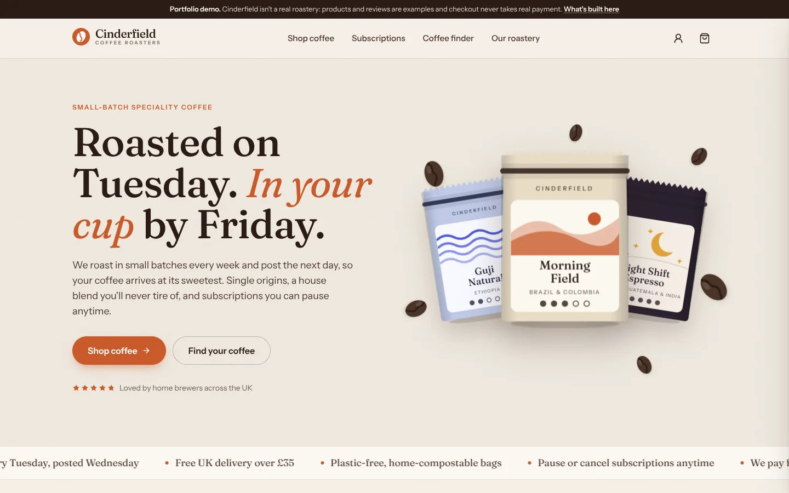
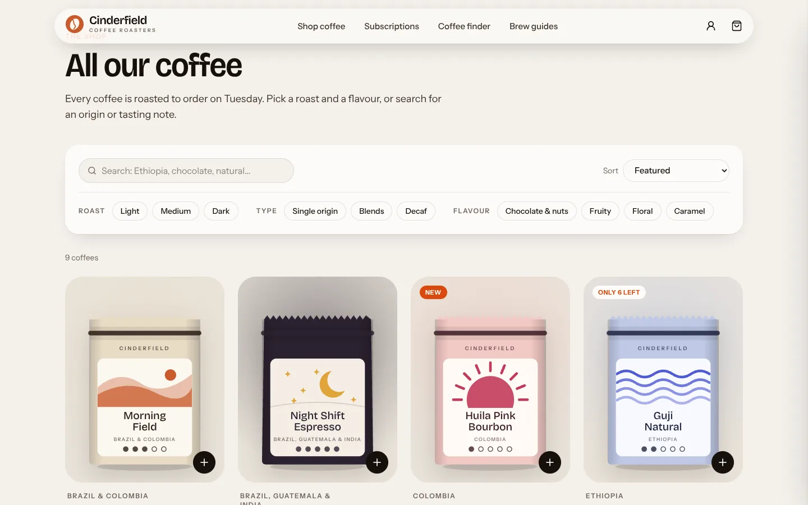
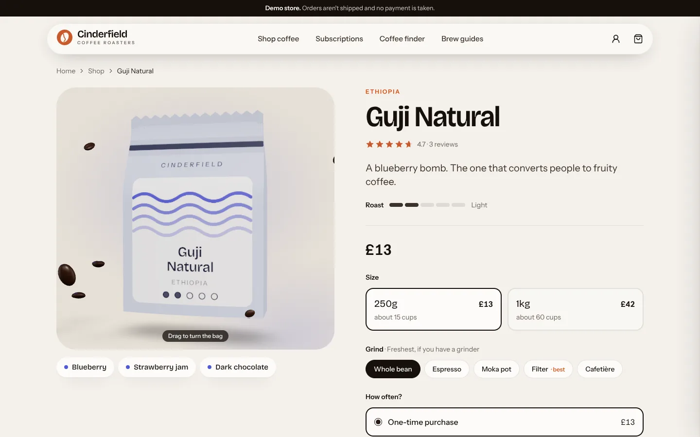
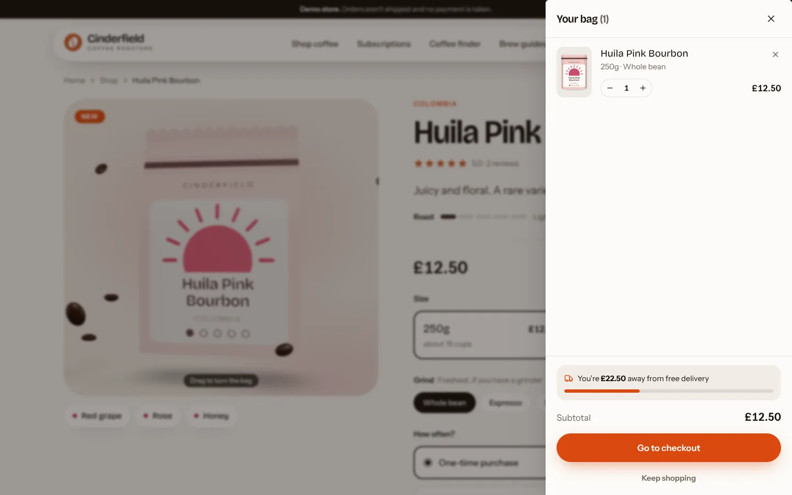
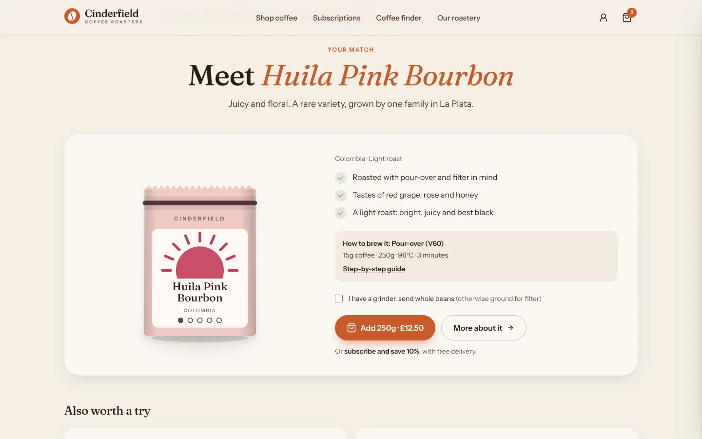
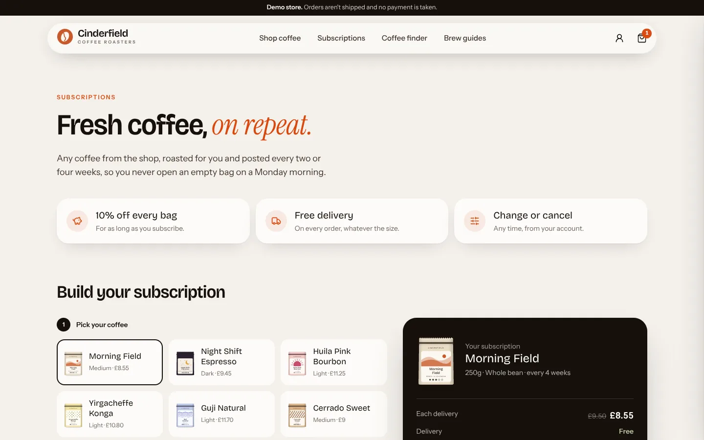
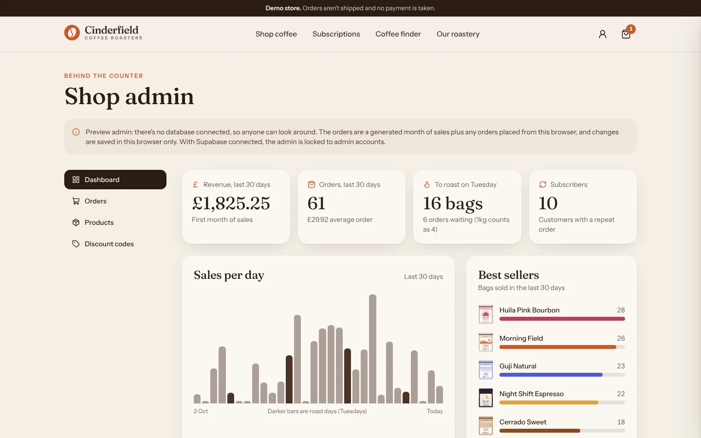
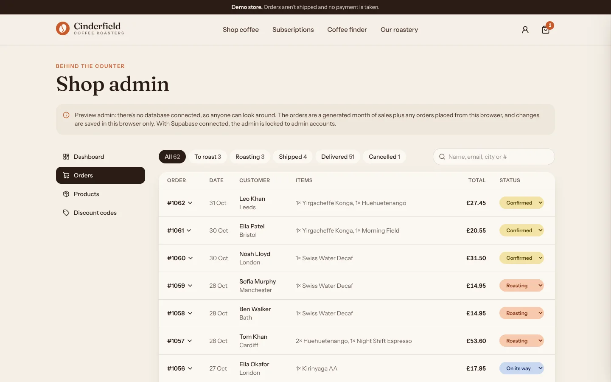
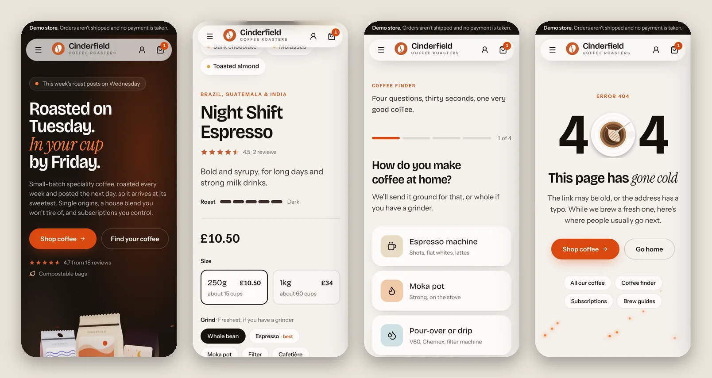

# Cinderfield Coffee Roasters

A complete online shop for a small-batch coffee roaster: catalogue, bag, checkout, subscriptions, customer accounts and an admin for the owner. Built with Next.js, Supabase and Stripe, and ready to hand over to a real roastery.



> Cinderfield is a sample brand: the coffees, prices and sample reviews are placeholders for the roaster's own. Until live Stripe keys are added, the site shows a one-line "demo store" notice with the Stripe test card, keeps itself out of search engines, and no real money changes hands.
>
> Built by Alexandra Badea · [Pages by Alexa](https://pagesbyalexa.com)

## What's in it

**For customers**

- Shop with search, filters (roast, type, flavour) and sorting. Filters live in the URL, so a filtered page can be shared or bookmarked.
- Product pages with tasting notes, origin details, a brew recipe for that coffee, reviews and structured data for search engines.
- A slide-out bag that's saved between visits, shows how far you are from free delivery and syncs across tabs.
- Discount codes: percentage off, fixed amount off, free delivery, with optional minimum spend. Try `WELCOME10`.
- Subscriptions every 2 or 4 weeks at 10% off with free delivery, and a subscription builder that shows the price per delivery, per month and what it saves in a year.
- A coffee finder quiz: four questions score every coffee in stock and explain why the match fits. Results have their own URL.
- Brew guides with a coffee-to-water calculator and a "fix my coffee" section.
- Customer accounts: sign up, sign in, forgot/reset password, change name and password, order history, and subscriptions with their next delivery date. "Update card or cancel" opens Stripe's customer portal.

**For the owner** (`/admin`)

- Dashboard: sales over 30 days, average order, how many bags to roast on Tuesday, best sellers and low stock.
- Orders that move from paid to roasting, shipped and delivered, with search and status filters.
- Edit prices and stock, feature a coffee on the home page or take it off sale. The shop updates immediately.
- Create discount codes and switch them off.

**Under the hood**

- The server re-prices every order from the database. The browser sends what's in the bag, never what it costs.
- Row Level Security on every table: customers can only read their own orders, and only admins can change products, orders and codes. The admin pages are locked by the database, not just hidden.
- Payments are confirmed twice over: the order page checks with Stripe, and the signed Stripe webhook does the same. Either can arrive first and repeats change nothing, so an order is never lost or counted twice.
- Every subscription renewal Stripe charges becomes a new order to roast, with stock taken off.
- The database sets itself up: each build applies any new migrations and loads the starting catalogue into an empty shop.
- Pages are prerendered and the catalogue is cached, then refreshed the moment an admin saves a change.
- Accessible: real buttons and form labels, visible focus, a skip link, keyboard-friendly quiz and drawer, and no animation for people who've turned motion off.
- Tests for pricing and discounts, the coffee finder, and every database security rule (run against real Postgres in memory with PGlite).

## Screenshots

| | |
|---|---|
|  |  |
|  |  |
|  |  |





## Stack

Next.js 16 (App Router, Cache Components) · React 19 · TypeScript · Tailwind CSS 4 · Supabase (Postgres, Auth, Row Level Security) · Stripe Checkout and webhooks · Vitest and PGlite · Vercel

## Running it

You need Node 20 or newer.

### On your machine

```bash
npm install
npm run dev
```

Open http://localhost:3000. With no keys, the shop runs on the catalogue in `src/data`, orders and admin changes are kept in your browser, and checkout takes no payment. Copy `.env.example` to `.env.local` and fill it in to connect Supabase and Stripe; `npm run db:migrate` then sets up the database.

### Deploying on Vercel, with Supabase and Stripe

1. **Import the repository** on [vercel.com/new](https://vercel.com/new). It deploys straight away, with no database and no payments.
2. **Add Supabase** from the project's Storage tab (Create Database → Supabase). Vercel creates the database and adds its keys to the project. The next build creates the tables and the starting coffees. For a demo store, also add `SEED_SAMPLE_REVIEWS` = `true`.
3. **Add Stripe** from the Vercel Marketplace (or paste your own test keys as `STRIPE_SECRET_KEY`). Checkout now goes through Stripe.
4. **Tell Supabase where the site lives.** In Supabase → Authentication → URL Configuration, set the Site URL to the shop's address and add `https://your-shop.com/**` to the redirect URLs, so confirmation and password-reset links come back to the shop.
5. **Add the Stripe webhook** (recommended): in Stripe → Developers → Webhooks, add `https://your-shop.com/api/stripe/webhook` with the events `checkout.session.completed`, `checkout.session.async_payment_succeeded`, `checkout.session.expired` and `invoice.paid`, then save its signing secret as `STRIPE_WEBHOOK_SECRET` in Vercel. Orders go through without it, but subscription renewals need it.
6. **Turn on Stripe's customer portal** (Stripe → Settings → Billing → Customer portal → Save), so customers can update their card or cancel.
7. **Redeploy**, create your account on the site, and make it an admin in Supabase's SQL editor:

   ```sql
   update public.profiles set role = 'admin'
   where id = (select id from auth.users where email = 'you@example.com');
   ```

To try a payment, use the card `4242 4242 4242 4242` with any future date and any CVC.

### Going live for a real shop

- Replace the coffees in `src/data/products.ts` (then `npm run db:seed-file`), or edit them in the admin.
- Don't set `SEED_SAMPLE_REVIEWS`, so the shop starts with real reviews only.
- Set `SHOP_EMAIL` to the shop's address and check the privacy and terms pages against the business.
- Switch on Stripe's emails for successful payments (Stripe → Settings → Customer emails), so customers get a receipt.
- Give Supabase your own email sender (Authentication → Emails → SMTP), since its built-in one is only meant for testing.
- Add the live Stripe keys and a live webhook. The demo-store notice and the noindex tag go away on their own.

## Scripts

| Command | What it does |
|---|---|
| `npm run dev` | Start the development server |
| `npm run build` / `npm start` | Production build (sets up the database first, if one is connected) and server |
| `npm run db:migrate` | Apply new migrations and load the starting catalogue |
| `npm test` | Run the tests (pricing, coffee finder, database security rules) |
| `npm run lint` | ESLint |
| `npm run typecheck` | TypeScript, without building |
| `npm run db:seed-file` | Rebuild `supabase/seed.sql` (and the sample reviews) from `src/data` |

## Where things are

```
src/
  app/                  pages and routes
    admin/              the owner's dashboard, orders, products and codes (+ server actions)
    api/checkout/       prices the bag on the server and starts Stripe Checkout
    api/stripe/webhook/ confirms payments and records subscription renewals
    account/            sign in, details, subscriptions and orders
  components/           UI, including the cart, quiz and admin tables
  data/                 the demo catalogue, reviews and discount codes
  lib/
    pricing.ts          every price, discount and delivery rule, in one place
    checkout.ts         checks a bag against the catalogue and stock
    catalog.ts          reads products and reviews (cached), from Supabase or src/data
    fulfil.ts           marks orders paid and turns renewals into orders
    finder.ts           the coffee finder's scoring
    browser-store.ts    local storage for the bag and demo data, without effects
  proxy.ts              keeps the Supabase session fresh
scripts/migrate.mjs     sets up and updates the database on every build
supabase/
  migrations/           tables, security rules and the stock function
  tests/                tests for every security rule, on an in-memory Postgres
```

## A few decisions

- **Prices are in pence**, as integers, everywhere. No floating-point pennies.
- **One pricing module** (`src/lib/pricing.ts`) is used by the bag, the checkout API and the admin, so the number a customer sees is the number they're charged.
- **It runs with or without its services.** With no keys, the same components and pricing run on built-in data, so the shop can be previewed anywhere; Supabase and Stripe switch on as their keys appear.
- **The bags are drawn in code** (SVG) instead of photographed. It keeps the demo light and lets a new coffee get its own bag with a few colours.

## Not built yet

- Order confirmation and shipping emails from the shop itself (Stripe's receipts cover payment confirmation). They'd go through a service like Resend, from the same webhook.
- Gift subscriptions.

## Licence

MIT. The fonts (Fraunces and Instrument Sans) are under the SIL Open Font License; see `src/fonts/OFL.txt`.
